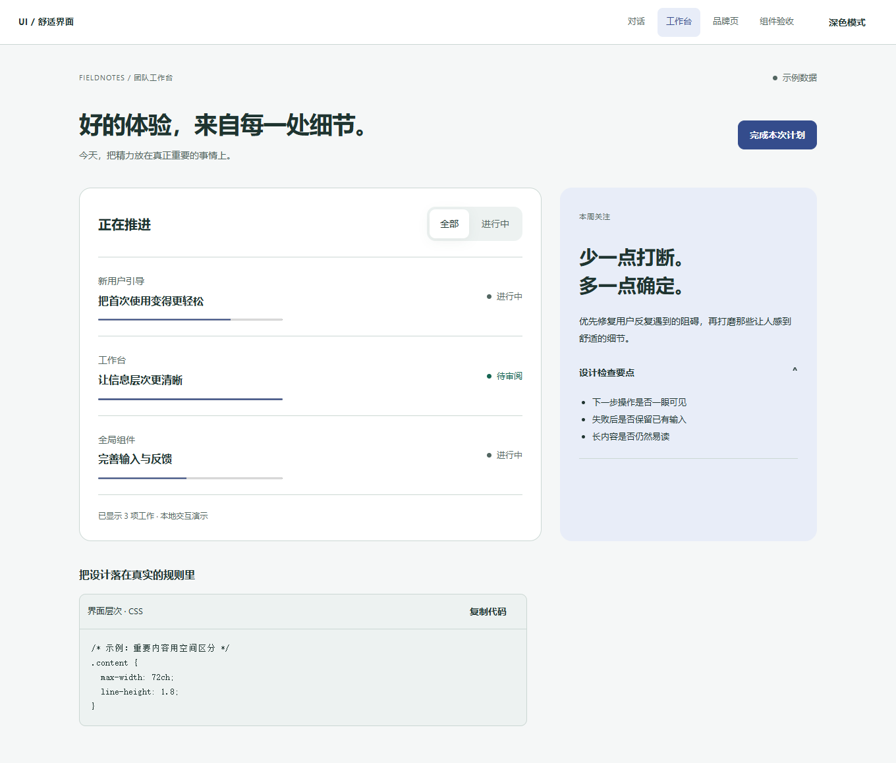
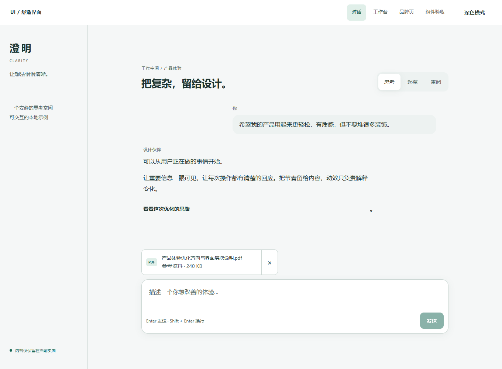
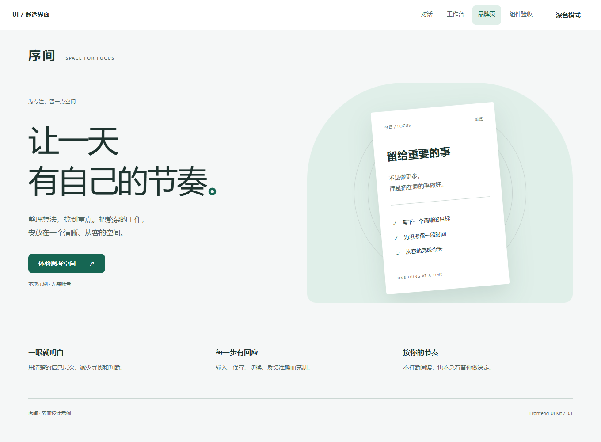
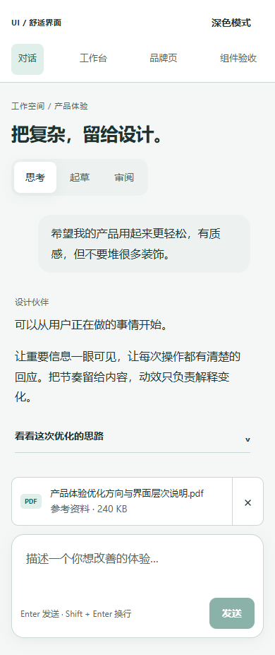

# Frontend UI Kit · 舒适界面

可安装的前端设计 Skill、8 类 React 组件配方、可交互页面和浏览器验收用例。由 [namgnal](https://github.com/namgnal) 维护，围绕信息层次、操作反馈、阅读稳定性和失败恢复构建。

**[在线体验](https://namgnal.github.io/frontend-ui-kit/)** · **[可选设计调节台](https://namgnal.github.io/frontend-ui-kit/tweaks.html)** · **[交互验收台](https://namgnal.github.io/frontend-ui-kit/#lab)** · [验证记录](docs/verification.md)



## 可以看到什么

| 内容 | 实现与体验 |
| --- | --- |
| 对话空间 | 异步发送、失败后保留草稿、输入法保护、阅读历史时停止自动跟随 |
| 团队工作台 | 信息层次、状态标签、任务筛选和反馈 |
| 品牌展示页 | 排版、分区、响应式布局和语义主题 |
| 组件验收台 | 键盘导航、独立附件操作、剪贴板失败反馈、滚动和输入边界 |
| 可选调节台 | 强调色、字号、间距、圆角、动效和标题；预设导入导出与原版比较 |

普通入口与调节台分开构建；正式页面不需要加载预览面板。配置应用脚本校验项目、版本和基线，仅更新约定的 JSON 配置，并保留备份。

<details><summary>查看对话、品牌页与手机效果</summary>





</details>

## 快速运行

使用 Node.js 22 或更高版本：

```bash
npm ci
npm run build
npm run preview
```

打开 `http://127.0.0.1:4174/`。演示在本地运行，无需 API key；对话、任务和附件是用于展示交互的示例数据。页面内的对话不会发送给模型服务。

## 作为 Skill 使用

将 `skills/frontend-ui-kit/` 整个目录复制到自己的 Codex skills 目录，例如 `~/.codex/skills/frontend-ui-kit/`，自定义 Codex 主目录时使用对应的 skills 目录。保留其中的许可证和来源记录。

调用示例：

> 用 $frontend-ui-kit 优化这个产品的前端，改善信息层次、操作反馈和阅读体验，保留现有品牌与功能。

需要亲自比较参数时再要求可选调节面板。React 配方可按需复用；Skill 本身也提供原生 HTML/CSS 的工作方式，不要求迁移现有产品技术栈。

## 验证与维护

```bash
npm run typecheck
npm run check:tokens
npm run test:tokens
npm run test:config
npm run build
npx playwright install chromium
npm test
```

也可通过环境变量 `FUI_BROWSER` 指定已有 Chromium 的可执行文件。测试自行启动本机 4174 端口；运行前避免其他服务占用。

测试覆盖异步输入、失败恢复、键盘与焦点、减少动效、参数校验及桌面/窄屏布局。自动化无障碍检查是验收的一部分，不等于完整的无障碍认证。细节见[验证记录](docs/verification.md)。

## 结构

```text
skills/frontend-ui-kit/  Skill、组件、主题、配置脚本与来源许可
demo/                    三类页面、验收台与独立调节入口
tests/                   47 项浏览器用例及 10 项脚本用例
scripts/                 构建、本机预览与截图工具
docs/                    演示截图与验证记录
```

## 设计与来源

此项目从开源组件模式和设计工作流出发，完成中文任务路由、组件重写、局部样式与语义主题、可选参数系统、三类示例页面和行为验收。它与 Anthropic / Claude 无关联，也不是任何第三方的官方设计系统。

主要参考 [Caho1/open-claude-ui](https://github.com/Caho1/open-claude-ui)（MIT）和 [imsai-sh/open-claude-design](https://github.com/imsai-sh/open-claude-design)（Apache-2.0）。固定版本及修改范围见 [sources.lock.json](skills/frontend-ui-kit/sources.lock.json)。本项目新增代码采用 MIT；衍生流程文档保留 Apache-2.0，详见 [LICENSES.md](LICENSES.md) 和 [NOTICE](skills/frontend-ui-kit/licenses/NOTICE.md)。

An interaction-focused UI toolkit: agent skill, React recipes, runnable demos, optional design controls, and reproducible browser checks. Chinese documentation; source attribution and license boundaries are included.
